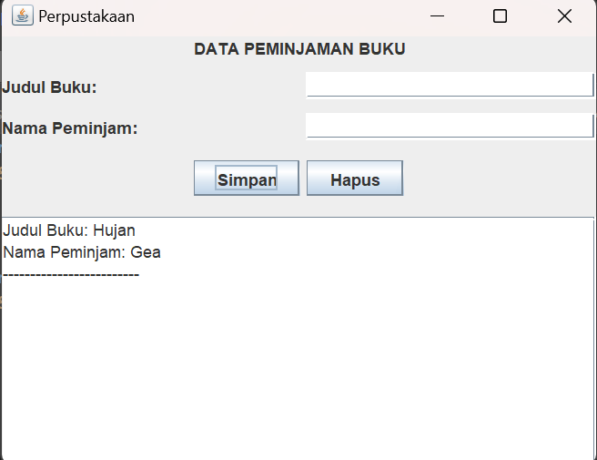

Nama: Gayatri Pradnya Aira Putri
NIM:F1D02410113

# Aplikasi Perpustakaan Sederhana

Aplikasi GUI Java Swing sederhana untuk mencatat peminjaman buku.

## Cara menggunakan
1. Isi Judul Buku.
2. Isi Nama Peminjam.
3. Klik tombol Simpan untuk menampilkan data pada area hasil.
4. Klik tombol Hapus untuk mengosongkan area hasil.

## Lima komponen utama GUI

1. **Top-Level Container: `JFrame`**  
   Digunakan sebagai jendela utama aplikasi.

2. **Intermediate Container: `JPanel`**  
   Digunakan untuk mengelompokkan judul, kolom input, dan tombol.

3. **Atomic Component: `JLabel`, `JTextField`, `JButton`, dan `JTextArea`**  
   Label memberikan keterangan, text field menerima input, button menjalankan perintah, dan text area menampilkan data peminjaman.

4. **Layout Classes: `BorderLayout` dan `GridLayout` (serta `FlowLayout`)**  
   BorderLayout mengatur bagian atas dan tengah jendela. GridLayout menyusun label dan kolom input. FlowLayout menyusun tombol.

5. **Event Listener: `ActionListener` dan `WindowAdapter`**  
   ActionListener menangani klik tombol Simpan dan Hapus. WindowAdapter menangani saat jendela ditutup.

## Screenshot
